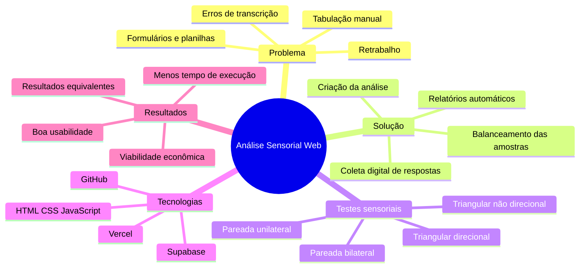
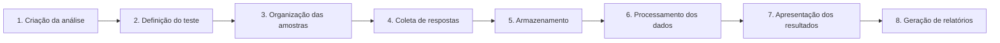
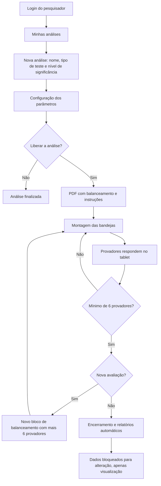
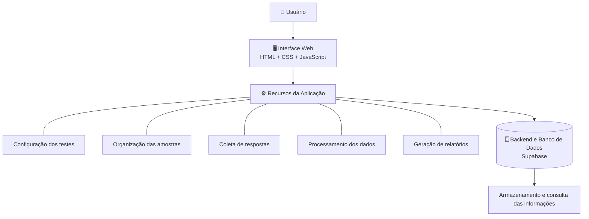
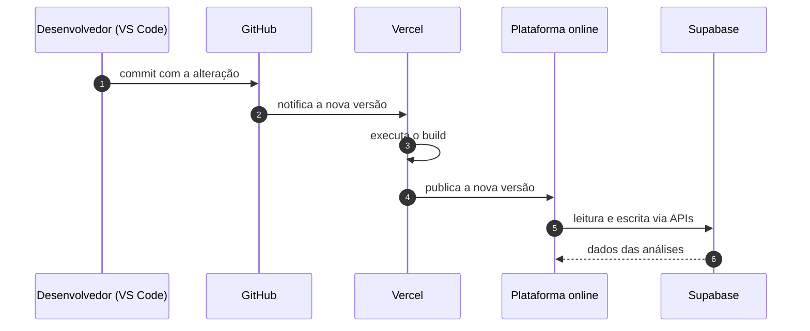
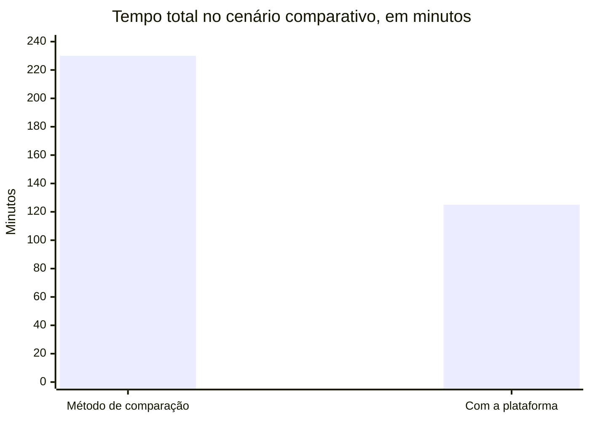
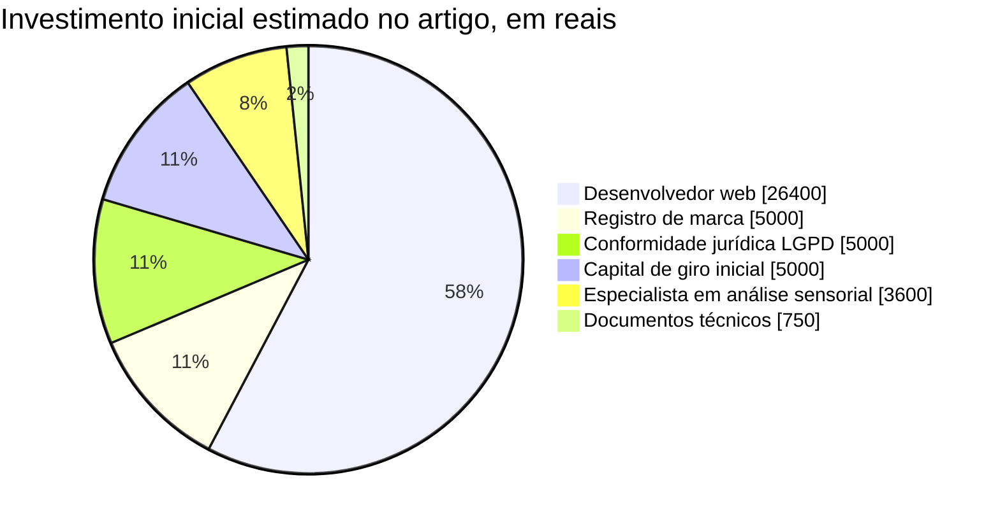
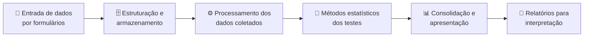

# Plataforma Web para Automação da Análise Sensorial de Alimentos

<p align="center">
  <a href="https://github.com/jcesarmph-ui/DataAnalytics"></a>
  <a href="https://github.com/jcesarmph-ui/DataAnalytics"></a>
</p>
<p align="center">
  <a href="https://developer.mozilla.org/docs/Web/JavaScript"></a>
  <a href="https://developer.mozilla.org/docs/Web/HTML"></a>
  <a href="https://developer.mozilla.org/docs/Web/CSS"></a>
  <a href="https://supabase.com/"></a>
  <a href="https://www.postgresql.org/"></a>
</p>
<p align="center">
  <a href="https://vercel.com/"></a>
  <a href="https://github.com/"></a>
  <a href="https://code.visualstudio.com/"></a>
</p>
<p align="center">
  
  
  
  
  
</p>

<p align="center">
  Trabalho de Conclusão de Curso, avaliado com <b>nota máxima</b>, que documenta o desenvolvimento de uma
  plataforma web para automatizar os processos de análise sensorial de produtos alimentícios.
</p>

<p align="center">
  <a href="#-visão-geral">Visão Geral</a> •
  <a href="#-problema-abordado">Problema</a> •
  <a href="#-solução-proposta">Solução</a> •
  <a href="#-funcionalidades">Funcionalidades</a> •
  <a href="#-arquitetura">Arquitetura</a> •
  <a href="#-validação-e-resultados">Resultados</a> •
  <a href="#-viabilidade-econômica">Viabilidade</a> •
  <a href="#-documento-completo">Documento</a>
</p>

---

## 📌 Visão Geral

A proposta consiste em reunir, em **um único ambiente digital**, etapas que tradicionalmente podem exigir
formulários, planilhas, cálculos estatísticos e tratamento manual de resultados. A plataforma foi concebida
para organizar os experimentos, padronizar procedimentos, facilitar a coleta de respostas e automatizar o
processamento dos dados.

O trabalho relaciona desenvolvimento web, automação de processos, estatística aplicada e análise de dados,
demonstrando como ferramentas digitais podem contribuir para a eficiência de atividades experimentais.

<table>
  <tr>
    <td align="center"><b>⏱️ 45,65%</b><br/>de redução no tempo total<br/>no cenário comparativo</td>
    <td align="center"><b>👥 26</b><br/>voluntários nos testes<br/>de usabilidade</td>
    <td align="center"><b>🧪 4</b><br/>modalidades de<br/>teste sensorial</td>
    <td align="center"><b>⚡ ~2 min</b><br/>para criar uma análise<br/>sem experiência prévia</td>
  </tr>
</table>

> [!NOTE]
> Este repositório reúne a **documentação do trabalho** (artigo completo em PDF). O código-fonte da
> plataforma não faz parte deste repositório.



<details>
<summary><b>🎓 Sobre o trabalho</b></summary>

| Item | Informação |
|---|---|
| Título | Plataforma web para automação dos processos de análise sensorial de produtos alimentícios |
| Autores | Sarah Vieira de Andrade, Júlio César Moreira Pereira, Lucas Silva de Alencar, Mykaella Soares Dutra |
| Orientador | Prof. Me. Glauco Rigolin |
| Curso | Bacharelado em Engenharia de Controle e Automação |
| Instituição | Faculdade Engenheiro Salvador Arena (FESA) — São Bernardo do Campo, SP |
| Período indicado no artigo | 08 a 11 de junho de 2026 |

</details>

## 🎯 Objetivos

O objetivo principal foi desenvolver uma plataforma web capaz de **automatizar e centralizar** as etapas de
realização de análises sensoriais de alimentos. Entre os objetivos específicos, destacam-se:

| | Objetivo específico |
|---|---|
| 🗂️ | Digitalizar e organizar a criação de análises sensoriais. |
| ⚙️ | Facilitar a configuração dos métodos de teste. |
| 🔀 | Automatizar o balanceamento e a identificação das amostras. |
| 📝 | Disponibilizar formulários digitais para os participantes. |
| 💾 | Coletar e armazenar as respostas de maneira estruturada. |
| 📊 | Processar os dados obtidos nos experimentos. |
| 📄 | Gerar resultados e relatórios automaticamente. |
| ⏱️ | Reduzir tarefas manuais e o tempo necessário para executar os procedimentos. |
| ⚖️ | Comparar os resultados da plataforma com métodos convencionais. |
| 💰 | Avaliar a usabilidade e a viabilidade econômica da solução. |

## ❓ Problema abordado

A análise sensorial é utilizada para avaliar características de produtos por meio das **percepções
humanas**. Em alimentos, pode auxiliar na comparação de formulações, na identificação de diferenças entre
amostras e na avaliação de características sensoriais.

Entretanto, a execução dessas análises pode envolver diversas atividades manuais, como organização dos
testes, balanceamento das amostras, aplicação de questionários, tabulação das respostas, realização de
cálculos e elaboração de relatórios.

> [!WARNING]
> Quando essas etapas são executadas com ferramentas desconectadas, o processo pode se tornar mais demorado e
> sujeito a **erros de transcrição, inconsistências e retrabalho**.

A plataforma apresentada no artigo busca solucionar esse problema por meio da integração das principais
etapas em um sistema web.

## 💡 Solução proposta

Uma aplicação web que centraliza o fluxo de trabalho da análise sensorial, desde a configuração do
experimento até a apresentação dos resultados.

### 🔄 Fluxo geral de funcionamento



| Etapa | Descrição |
|---|---|
| 1. **Criação da análise** | Configuração do experimento e dos parâmetros necessários. |
| 2. **Definição do teste** | Seleção e configuração do método de análise sensorial. |
| 3. **Organização das amostras** | Realização do balanceamento e preparação das identificações. |
| 4. **Coleta de respostas** | Disponibilização da interface digital para os participantes. |
| 5. **Armazenamento** | Organização das respostas coletadas. |
| 6. **Processamento dos dados** | Execução dos procedimentos de análise previstos no sistema. |
| 7. **Apresentação dos resultados** | Disponibilização dos resultados processados. |
| 8. **Geração de relatórios** | Consolidação das informações obtidas no experimento. |

Esse fluxo reduz a necessidade de transferir manualmente informações entre diferentes ferramentas e
favorece a padronização das atividades.

<details>
<summary><b>🧭 Fluxograma funcional detalhado, conforme o artigo</b> (clique para expandir)</summary>



</details>

## ✨ Funcionalidades

Com base na descrição do artigo, a plataforma contempla funcionalidades relacionadas a:

<table>
  <tr>
    <td valign="top" width="50%">

**🛠️ Preparação**

- Criação e configuração de análises sensoriais.
- Organização e balanceamento de amostras.
- Identificação das amostras utilizadas nos testes.
- Coleta digital de respostas dos participantes.
- Armazenamento estruturado das informações.

</td>
    <td valign="top" width="50%">

**📊 Processamento e resultados**

- Processamento automatizado dos dados.
- Aplicação de procedimentos estatísticos associados aos testes.
- Apresentação dos resultados.
- Geração de relatórios.
- Comparação dos resultados com métodos convencionais.

</td>
  </tr>
</table>

<details>
<summary><b>🖥️ Detalhes da interface descritos no artigo</b></summary>

| Recurso | Descrição |
|---|---|
| Tela de login | Dois tipos de acesso: **administrador** (configura e gerencia as análises) e **análise sensorial** (provador). Também dá acesso ao manual de utilização. |
| Menu lateral | *Página Inicial*, *Minhas Análises*, *Manuais*, *Sobre o Projeto* e *Logout*. |
| Nova análise | Botão **+ Nova Análise**: nome, tipo de teste e nível de significância. |
| Modalidades de teste | Triangular direcional, triangular não direcional, pareada bilateral e pareada unilateral. |
| Níveis de significância | 5%, 1%, 0,5% e 0,1%. |
| Acompanhamento da análise | Geração do balanceamento, visualização do formulário, geração de relatórios e exportação em **CSV**; número de respostas e resultados preliminares em tempo real. |
| Amostras | Códigos numéricos gerados automaticamente, sem possibilidade de alteração. |

</details>

O artigo também descreve testes envolvendo diferentes modalidades de análise sensorial. Para conhecer os
detalhes de cada método e das respectivas telas, consulte o [PDF disponibilizado neste repositório](#-documento-completo).

## 🧱 Arquitetura

O artigo descreve uma aplicação web organizada em componentes de **frontend, backend e banco de dados**,
com utilização de ferramentas como GitHub, Vercel e Supabase. De forma conceitual:



A publicação da aplicação está associada à utilização da **Vercel**, enquanto o **GitHub** oferece suporte à
organização e ao versionamento dos arquivos:



> [!NOTE]
> Os esquemas representam uma **visão conceitual** do sistema, e não um diagrama técnico completo de todos
> os componentes internos.

### 🧰 Tecnologias utilizadas

| Tecnologia | Aplicação no projeto |
|---|---|
| **HTML5** | Estruturação do conteúdo das páginas. |
| **CSS3** | Apresentação visual e estilização da interface. |
| **JavaScript** | Implementação de comportamentos e interações da aplicação. |
| **Supabase** | Plataforma utilizada para dar suporte aos recursos de backend e banco de dados (baseada em PostgreSQL, segundo o artigo). Sua função específica na arquitetura deve ser compreendida em conjunto com a implementação descrita no artigo. |
| **Vercel** | Publicação e hospedagem de aplicações web, utilizada no contexto do desenvolvimento apresentado. |
| **GitHub** | Hospedagem de repositórios, organização dos arquivos do projeto, controle de versões e colaboração. |
| **VS Code** | Ambiente de desenvolvimento citado no artigo. |

> [!TIP]
> Os badges identificam as tecnologias e ferramentas mencionadas no trabalho. A descrição detalhada de sua
> implementação deve ser consultada no artigo original.

## 📈 Validação e resultados

Foram realizados testes práticos para verificar o funcionamento da plataforma e comparar os resultados com
métodos convencionais utilizados em ambiente acadêmico. Os resultados apresentados indicaram que:

- ✅ A plataforma **reproduziu corretamente** os resultados obtidos pelos métodos de comparação utilizados nos
  testes descritos.
- ⚡ A criação de uma análise por um usuário sem experiência prévia ocorreu em **aproximadamente dois
  minutos** no cenário apresentado.
- 👥 Foram realizados testes de usabilidade com a participação de **26 voluntários**.
- 👍 Os participantes demonstraram aceitação da ferramenta e indicaram interesse em utilizá-la em atividades
  práticas de análise sensorial.
- ⏱️ Houve redução do tempo necessário para executar etapas como balanceamento, tabulação e geração de
  relatórios.

### ⏱️ Redução do tempo de execução

No cenário comparativo apresentado no artigo (análise com 40 provadores, sem contar o tempo de login), o
tempo total passou de **3 horas e 50 minutos** para **2 horas e 5 minutos**.

| Indicador | Resultado |
|---|---:|
| Tempo pelo método de comparação | 3 h 50 min |
| Tempo com a plataforma | 2 h 05 min |
| Tempo economizado | 1 h 45 min |
| Redução percentual reportada | **45,65%** |



> [!IMPORTANT]
> Esses valores correspondem ao cenário experimental descrito pelos autores e **não representam uma garantia
> de desempenho** em qualquer contexto de utilização.

## 💰 Viabilidade econômica

O trabalho também contempla uma análise de viabilidade econômica, considerando estimativas de mão de obra,
despesas operacionais, investimento inicial e projeções financeiras. Essa análise busca avaliar o potencial
de aplicação da plataforma em contextos acadêmicos e profissionais.



<details>
<summary><b>📑 Principais números do estudo</b></summary>

| Item | Valor reportado no artigo |
|---|---|
| Custo de desenvolvimento (mão de obra) | R$ 30.750,00 |
| Investimento inicial total | R$ 45.750,00 |
| Custos e despesas mensais estimados | R$ 849,03 |
| Assinatura anual considerada por cliente | R$ 5.000,00 |
| Taxa Mínima de Atratividade (TMA) | 18% ao ano |
| VPL / TIR / payback — cenário sem funcionário | R$ 268.260,38 / 74,33% / 2 anos e 7 meses |
| VPL / TIR / payback — cenário com funcionário | R$ 76.748,39 / 30,39% / 6 anos e 11 meses |

</details>

> [!NOTE]
> Os valores e indicadores econômicos devem ser interpretados conforme as **premissas utilizadas no estudo**.
> Para consultar as tabelas e os cálculos completos, utilize o artigo original em PDF.

## 🤖 Relação com Engenharia de Controle e Automação

O projeto apresenta relação com a Engenharia de Controle e Automação por meio da análise e melhoria de
processos, da padronização de procedimentos e da automação de tarefas repetitivas. Embora a solução seja
baseada em software e não dependa de equipamentos físicos para representar seu fluxo principal, seus
conceitos estão associados a competências importantes da engenharia:

| | Competência |
|---|---|
| 🗺️ | Mapeamento e organização de processos. |
| 🔍 | Identificação de atividades manuais e oportunidades de melhoria. |
| ⚙️ | Automação de etapas operacionais. |
| 📏 | Padronização de procedimentos. |
| ♻️ | Redução de retrabalho. |
| 📈 | Avaliação de desempenho e eficiência. |
| ✅ | Validação de uma solução por meio de testes. |

A plataforma demonstra como princípios de automação podem ser aplicados a processos experimentais e
administrativos por meio de tecnologias digitais.

## 📊 Relação com Ciência de Dados

A solução também se relaciona com Ciência de Dados, principalmente nas etapas de coleta, armazenamento,
organização e processamento das respostas obtidas nos experimentos.



Essas atividades demonstram a importância da qualidade dos dados, da padronização dos procedimentos e da
automação do processamento para a obtenção de resultados consistentes.

## 🌍 Aplicações potenciais

A proposta possui potencial de utilização em diferentes contextos, conforme as necessidades de cada
organização:

- 🏫 Instituições de ensino e laboratórios acadêmicos.
- 🍽️ Atividades práticas de análise sensorial.
- ⚖️ Estudos comparativos de produtos alimentícios.
- 🔬 Pesquisas relacionadas ao desenvolvimento de produtos.
- 🏭 Ambientes profissionais que realizam avaliações sensoriais.
- 🧪 Processos experimentais que necessitam de coleta estruturada e processamento de respostas.

A adequação a cada contexto depende dos requisitos técnicos, dos métodos de análise utilizados e das
condições de implantação.

## 📄 Documento completo

**Documento principal:** [📥 Acessar o artigo completo em PDF](PFC%20-%20Plataforma%20web%20para%20automa%C3%A7%C3%A3o%20dos%20processos%20de%20an%C3%A1lise%20sensorial%20de%20produtos%20aliment%C3%ADcios.pdf)

## 📁 Estrutura do Repositório

```text
PlataformaWeb-AnaliseSensorial/
├── PFC - Plataforma web para automação dos processos de análise sensorial de produtos alimentícios.pdf
│                               # artigo completo do TCC
└── README.md                   # esta apresentação
```

---

<p align="center">
  <b>Categoria:</b> Engenharia de Controle e Automação · Desenvolvimento Web · Automação de Processos ·
  Análise de Dados · Análise Sensorial
</p>

<p align="center">
  <b>Projeto acadêmico que integra desenvolvimento web, automação de processos e análise de dados para tornar
  a análise sensorial de alimentos mais rápida, padronizada e confiável.</b>
</p>
